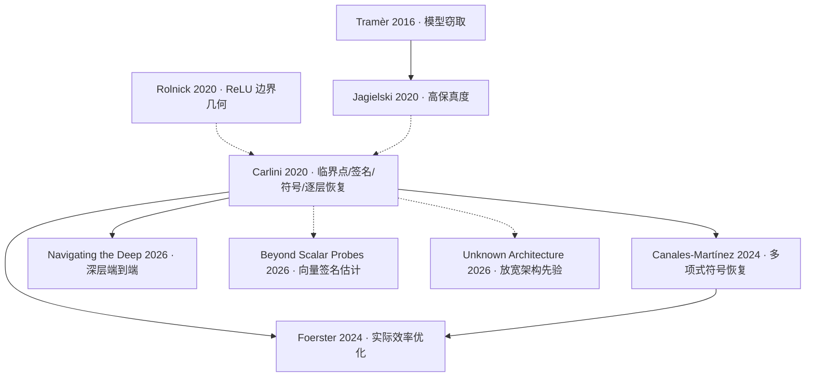
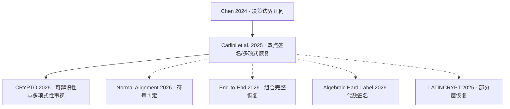

# Awesome Cryptanalytic Model Extraction — 技术演进版

**按技术演进脉络整理神经网络密码分析提取文献**  
*A literature roadmap of cryptanalytic neural-network model extraction, organized by research dependencies rather than only architecture or publication date.*

[📚 全部 55 篇论文](docs/papers.md) · [🧭 技术演进详解](docs/evolution.md) · [🔗 论文继承关系表](docs/relationships.md) · [📖 阅读路线](docs/reading-guide.md) · [📂 JSON](data/papers.json) · [CSV](data/papers.csv)

> 更新时间：2026-11-03。初版依据 [springli07/awesome-cryptanalytic-extraction](https://github.com/springli07/awesome-cryptanalytic-extraction/blob/main/README_zh-CN.md) 的 2026-10-28 文献目录整理。收录 **55 篇**，包括预印本、综述、撤回历史文献和课程报告；并不表示已核验每篇论文的所有技术细节。

## 为什么另建一个索引？

传统 awesome list 回答 **“有哪些论文？”**；这里更关注 **“为什么会有下一篇？它解决了上一阶段什么问题？”**。因此以 **问题 → 代表工作 → 方法 → 瓶颈 → 后续改进** 组织，并将不同 oracle、不同恢复对象和不同证据强度分开。

## 研究主线一：Raw-output ReLU / Soft-label 相关

**① [Carlini et al., CRYPTO 2020](https://arxiv.org/abs/2003.04884)**：系统化利用 ReLU 分段线性结构，将提取分为临界点识别、神经元签名恢复、符号恢复和逐层重建。**遗留问题**：符号枚举、深层临界点与误差累积。

**② [Canales-Martínez et al., EUROCRYPT 2024](https://eprint.iacr.org/2023/1526)**：继承经典流水线，通过 SOE / Neuron Wiggle 等技术改善符号恢复，在相应假设下取得多项式时间结果。**遗留问题**：理论复杂度并不直接意味着实际查询成本低。

**③ [Foerster et al., NeurIPS 2024](https://arxiv.org/abs/2406.10011)**：在上述方案基础上改善符号恢复与系统实现，重新识别真实攻击瓶颈。**遗留问题**：深层网络整体提取仍然困难。

**④ [Navigating the Deep, EUROCRYPT 2026](https://eprint.iacr.org/2026/296)**：面向深层 ReLU 改进临界点筛选、签名识别与端到端流程。

**并行分支**：[Beyond Scalar Probes (2026)](https://arxiv.org/abs/2609.35487) 优化向量输出下的签名估计；[Without Known Architecture (2026)](https://arxiv.org/abs/2609.14379) 放宽架构知识。它们针对不同瓶颈，不能简单看作彼此直接继承。

> **术语说明**：raw logits、完整 softmax 概率、top-k 概率并非同一个 oracle；论文归档的 “raw-output” 不应全部称为 soft-label API 攻击。

## 研究主线二：Hard-label / Top-1 ReLU

**① [Chen et al., ASIACRYPT 2024](https://eprint.iacr.org/2024/1403)**：在只看到 top-1 类别的条件下，从决策边界几何中构建可观测恢复信号。**瓶颈**：效率与可恢复网络类别。

**② [Carlini et al., EUROCRYPT 2025](https://eprint.iacr.org/2024/1580)**：引入双点签名及符号恢复思路，在结构和可观测性条件下改善复杂度。注意区分完全黑盒端到端演示与更大规模的辅助实验。

**③ [Is the Hard-Label ... Really Polynomial?, CRYPTO 2026](https://eprint.iacr.org/2025/1868)**：分析持久/死亡神经元、跨层提取和多项式性依赖条件，属于对前述定理适用范围的审视。

**④ 2026 年平行优化**：[Normal Alignment](https://arxiv.org/abs/2609.18751) 改善符号恢复；[Algebraic Hard-Label](https://eprint.iacr.org/2026/1164) 改进签名与聚类；[End-to-End Hard-Label](https://arxiv.org/abs/2609.21941) 在特定已知架构下组合出端到端提取。

## 技术分支导航

| 方向 | 主要问题 | 代表进展 |
|---|---|---|
| [CNN 与池化](docs/papers.md#cnn-与池化扩展5-篇) | 权重共享、池化切换、空间结构 | 平均池化 → max-pooling → 端到端与未知架构 |
| [激活函数](docs/papers.md#激活函数扩展4-篇) | ReLU 非光滑性不再普适 | PReLU / LeakyReLU → 光滑激活高阶/曲率 |
| [RNN 与 GNN](docs/papers.md#rnn-与-gnn-扩展2-篇) | 时间共享与消息传递 | 2026 年针对特定模型开展恢复 |
| [Attention / GLU](docs/papers.md#注意力与-glu-扩展5-篇) | 非 ReLU 组件与参数等价性 | 注意力查询学习、Softmax Attention、GLU、FFN 曲率 |
| [LLM 部分恢复](docs/papers.md#llm-部分恢复2-篇) | API logprobs 泄漏 | 输出投影 / 子空间恢复；非整网窃取 |
| [PPML / 侧信道](docs/papers.md#ppml-与侧信道6-篇) | 更强 oracle、实现泄漏 | 故障、物理侧信道、定点/有限环 |
| [数值与防御](docs/papers.md#有限精度与防御3-篇) | 理论攻击能否落地 | 有限精度、输出舍入、训练防御 |
| [相关理论](docs/papers.md#相关理论与替代恢复8-篇) | 可辨识性、优化式参数恢复 | Expand-and-Cluster → Data Augmentation |

## 继承关系如何标注？

- **方法改进**：后作在前作具体恢复原语上做改进（如符号恢复）。
- **技术延伸**：采用相似几何/代数思想，改变对象、条件或优化目标。
- **假设审视**：分析先前复杂度定理或恢复条件的边界。
- **平行路线**：同一技术问题下的不同方法，**不应画成直接继承**。

现阶段 [关系数据](data/relations.json) 是研究脉络归纳，**尚未完成 55 篇论文逐条引用关系审计**。如需严格的 citation graph，必须逐篇附上论文原文对应段落。虚线表示启发/并行技术联系，不应解读为直接引用。

## 完整资料与维护

- **[文献全集：55 篇](docs/papers.md)**：包含官方链接、年份、发表/撤回状态、oracle、方法定位及边界。
- **[详细演进](docs/evolution.md)**：解释“前作解决什么、留下什么、后作为何出现”。
- **[关系表](docs/relationships.md)**：提供上游 → 下游、关系类型和新解决的问题。
- **[学习路线](docs/reading-guide.md)**：结构恢复、硬标签、实际可行性三条精读路径。
- **数据格式**：`data/papers.json`、`data/papers.csv`、`data/relations.json`；运行 `python scripts/check_catalog.py` 检查基本一致性。

## 来源与声明

本项目参考并明确致谢 [springli07/awesome-cryptanalytic-extraction](https://github.com/springli07/awesome-cryptanalytic-extraction) 的初始文献集合，在其基础上按**研究脉络**重新编排。原始目录包含的 *withdrawn* 与 *preprint* 会明确标注；不上传第三方论文 PDF，不将源码链接未核验、部分模块提取或有限样本一致率夸大为整个模型的精确恢复。

**用途**：仅用于学术研究、理解授权模型系统的安全边界与防御。欢迎通过 PR 提交更完整的引用证据和勘误，见 [CONTRIBUTING.md](CONTRIBUTING.md)。
